# Brushes, and painting trees

What each brush does, what the settings on the brush bar change, and four ways to paint trees and mountains with the brushes made for them: a cottonwood in leaves and bark, a fir tapped in with the fan, snow knifed onto a mountain, and colour laid over a pencil drawing. Needs Easeletch 0.14 or later.

Every brush mark in these pictures was made by Easeletch's own brushes, most of them on the *Cotton* paper.

A pen and tablet make the most of these brushes, because most of them change with how hard you press. A mouse paints every stroke at full pressure. Section 2 says what that means for each one.

## 1. Choose a brush

Press **B**, or click the **Brush** button at the top of the tool strip. Click its arrow, or click the button again when the brush is already in use, to open the list.

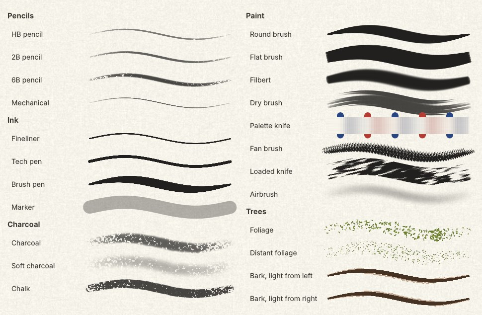

The list is in two columns, and every brush shows a sample of its stroke pressed lightly, then hard, then lightly again:

- **Pencils** catch the paper's grain and darken more than they widen as you press.
- **Ink** is solid and hard-edged, and a little steadied.
- **Charcoal** and chalk are grainy and crumble at the edges.
- **Paint** brushes have shaped tips that turn with the stroke. The flat, filbert and dry brush show their bristles; the palette knife lays no paint and pushes what's there; the fan and the loaded knife are for trees and mountains (Sections 6 and 7).
- **Trees** are the foliage and bark brushes (Section 5).

Choosing a brush sets every setting to that brush's own. Change anything you like after that; choosing the brush again puts it back.

## 2. The settings on the bar

The bar above the canvas shows the brush's name and its settings.

- **Size** is the width of the brush at full pressure. **[** and **]** make it smaller and larger.
- **Opacity** is the most a single stroke covers. Going back over your own stroke before you lift the pen doesn't make it darker; a new stroke over it does.
- **Hardness** is how sharp the edge is: soft at 0%, crisp at 100%.
- **Stabilizer** smooths a shaky line. The more of it, the further the line trails behind the pen, so keep it low for quick marks and raise it for long, clean curves.
- **Pressure size** makes the line wider as you press harder. **Pressure opacity** makes it more solid.
- **Pixel** paints hard pixels with no soft edge, for pixel art.
- **Mirror** paints the other side as you paint this one.

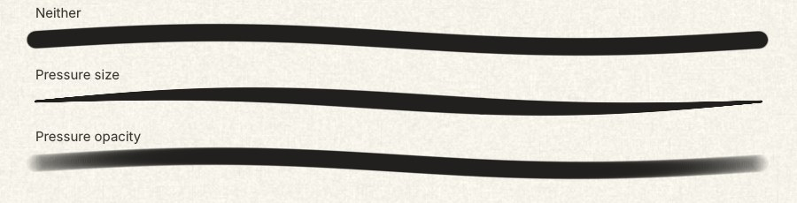

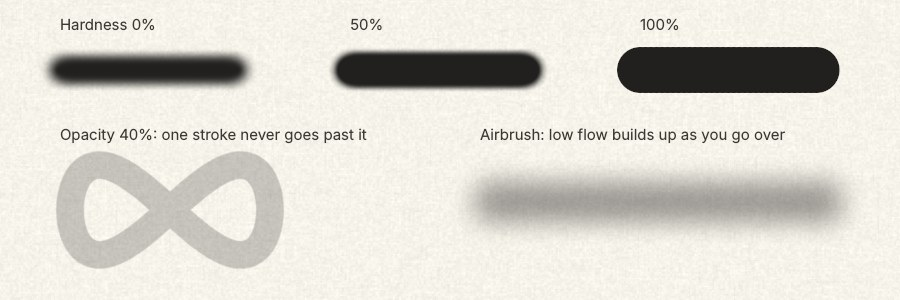

**With a mouse**, every touch is full pressure. Pressure size and pressure opacity have nothing to change, and the brushes that do most with pressure behave as if pressed hard: Foliage lays its full count of leaves, the Fan its full spread, and the Loaded knife covers more than it skips. Lower **Size** for the lighter look, and for the knife raise **Grain** (Section 3) to make it skip more.

## 3. More settings

Click **More** on the bar for three more.

- **Flow** is how much each touch of the brush lays down. Low flow builds up slowly as you go over the same place, the way the airbrush does; it never goes past the Opacity.
- **Spacing** is how far apart the brush touches the canvas along a stroke, as a share of its size. At 100% and over, the stroke becomes a row of dots.
- **Grain** is the paper. At 0 the mark is smooth. Higher, a light touch only catches the paper's high points and pressing harder fills the hollows: what makes a stroke read as pencil or charcoal rather than paint.

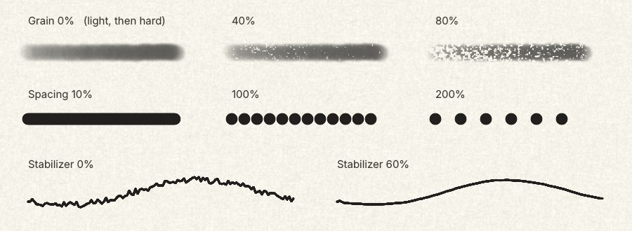

## 4. Shaped tips

The flat brush, filbert, dry brush and the knives have a tip that is wide one way and thin the other. It turns with the stroke, so it always paints at full width, as a brush pulled along does.

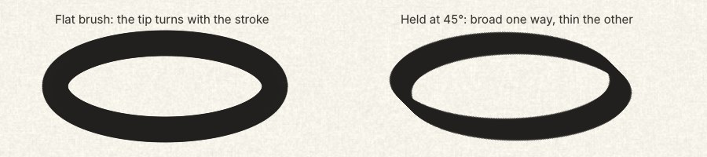

Two things that help with any brush:

- **Shift-click** draws a straight line from where the last stroke ended.
- **Hold Alt** and click to pick up a colour from the canvas without leaving the brush.

## 5. A cottonwood: foliage, then bark

The way painters do leaves: dark first, then lighter on top, each pass covering less, with the light coming from one side. The **Foliage** brush lays a cluster of small leaf shapes with every touch, each a slightly different size, angle and shade of the colour you're painting with. Press harder for more leaves.

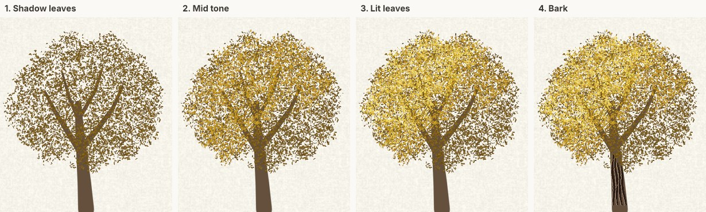

1. Paint the trunk and the main limbs in a mid brown with the **Round brush**, Pressure size on, so they taper as you lift.
2. Click **New** in the Layers panel for a layer for the leaves.
3. Choose **Foliage** and a deep olive-gold. Dab over the whole crown: short strokes, a few at a time, leaving gaps. Let some leaves cross the limbs and leave some of the limbs showing.
4. Choose a mid gold and go over most of the crown again, leaving the side away from the light in the dark colour.
5. Choose a pale, bright gold and touch in the sunlit side only, the edges of the clumps most of all.

Two things make it read as a tree rather than a blob:

- **Pick each pass's colour on purpose.** Each should be clearly darker or lighter than the last. Colours picked straight from a photo tend to come out muddy, because a photo's leaves are mixed with the shade between them.
- **Keep the outline broken.** Clumps and gaps at the edge of the crown; a smooth edge looks cut out and pasted on.

For trees far off, **Distant foliage** lays a fine speckle in the same way.

### Bark

The **Bark** brushes cut a dark groove that tapers at both ends, with a thin light edge beside it on the side the light comes from. Choose *Bark, light from left* or *Bark, light from right* to match the light on the leaves.

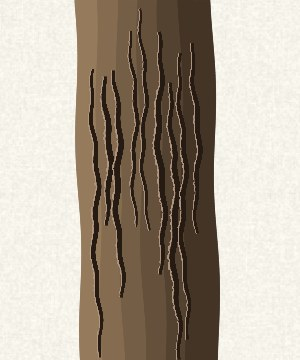

1. Paint the trunk in a few strokes of the **Flat brush** running up it: the lit side lightest, the shadow side darkest.
2. Choose the **Bark** brush for your light, and a colour much darker than the trunk.
3. Cut grooves up the trunk, pressing lightly at each end. Vary their lengths and let them wander; no two the same.

Bark wants a fine touch: a size of 4 to 6 on a trunk this wide, and each groove placed by eye where a ridge would be. Laid evenly, grooves look like stripes. Where the leaves hide the trunk, stop the grooves.

## 6. A fir with the fan brush

The **Fan brush** spreads its bristles in an arc, and each touch leaves a row of separate marks that droop away from the handle, like the end of a fir bough. Tapped, not pulled.

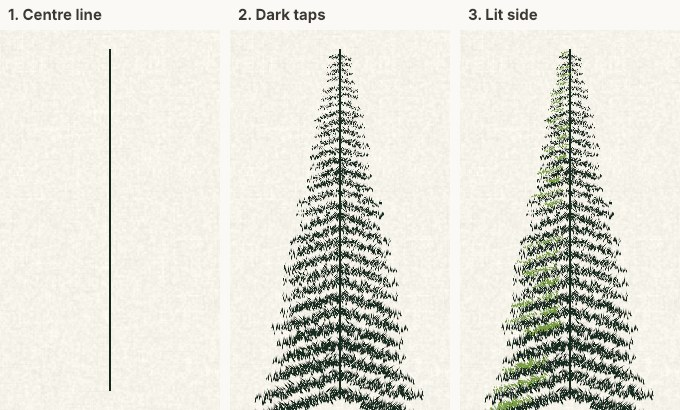

1. Draw the trunk as one thin, dark line with the **Round brush** at a size of about 3.
2. Choose the **Fan brush** and a very dark green. Starting at the top, tap the boughs on in tiers going down: a few short taps out from the trunk on each side, then leave a small gap and start the next tier a little lower. Make each tier wider than the last, and lower **Size** for the narrow top.
3. Each tap droops on its own. For boughs that slope down and away from the trunk, put each tap a little lower than the one before as you move out along the tier.
4. Choose a yellow-green and tap a few highlights on the side the light comes from, on the top edge of the boughs. Fewer than you think; most of the tree stays dark.

Pulled instead of tapped, the fan lays bristle streaks: grass, or a row of twigs.

## 7. Snow on a mountain with the loaded knife

The **Loaded knife** lays paint, but only where it catches. Pulled lightly, it skips and leaves broken streaks running the way it was pulled; pressed hard, it covers. That broken edge is what reads as snow and rock.

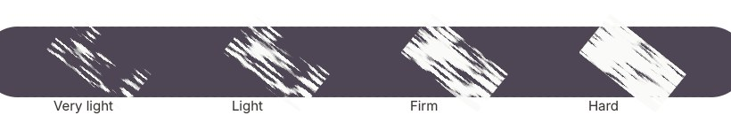

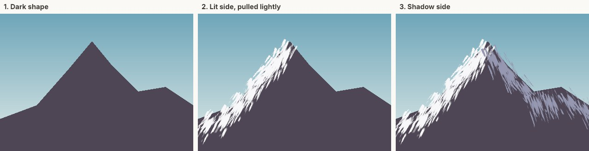

1. Paint the mountain's shape in a dark grey-violet. The **Shape** tool, or a large brush, does it quickly.
2. Choose the **Loaded knife** and white. Start each stroke on the ridge line and pull it down and outward, short and light, following the slope. Lift before the bottom; snow thins out lower down.
3. Choose a blue-grey and do the same down the side away from the light.
4. Go back over the top of the peak with a little more pressure where the snow lies thickest.

Keep the strokes short and let the dark show between them. If the knife covers too much, press more lightly; with a mouse, raise **Grain** under **More**.

## 8. Colour over a pencil drawing

For a pencil drawing, put the colour on its own layer set to **Multiply**. Multiply darkens what's underneath by the colour, so every pencil line and every patch of shading stays as it was, and the drawing does the light and dark while the brushes add the colour.

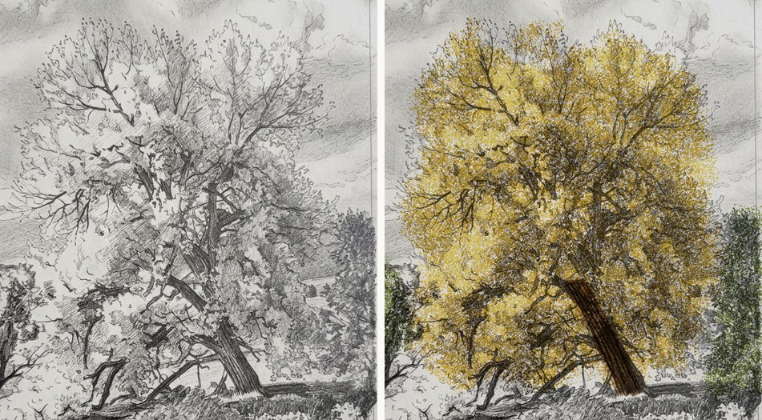

1. Open the drawing. Click **New** in the Layers panel, and set the new layer's blend mode (the list at the top of the Layers panel, showing *Normal*) to **Multiply**.
2. Choose **Foliage** and go over the crown in three passes as in Section 5, letting the drawing guide you: the darkest colour over the hatched shadows, the middle one over the mid tones, the lightest where the paper is bare.
3. Add another Multiply layer for the trunk. A thin brown at about 50% layer opacity is enough; the drawing already has the bark.

Because Multiply over grey shading darkens on its own, the colours can be lighter than you'd pick for paint on white.
